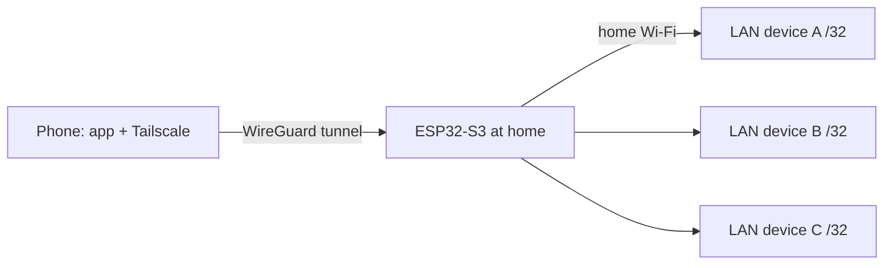

# ESP32 Tailscale Subnet Router

Turn a $20 ESP32-S3 board into a **Tailscale subnet router** that runs on Arduino, with no computer or Raspberry Pi needed. We use it to reach home Bitaxe-style miners (AxeOS) from anywhere with the [HashFleet](https://github.com/SMWARREN/HashFleet) app ([setup guide](https://github.com/SMWARREN/HashFleet/blob/main/docs/REMOTE-ACCESS-TAILSCALE.md)), using their normal LAN addresses. The same approach works for any small set of LAN devices.

**Status:** working and validated on 2026-11-09. A phone on cellular with Tailscale on could reach and control all four miners through the board. With Tailscale off they were unreachable.

> Not affiliated with or endorsed by Tailscale Inc. MicroLink is an independent, community-written client that speaks the Tailscale protocol.

## What we used

| Part | What it is |
| --- | --- |
| **Board** | Hiwonder **"ESP32S3 Large Model Board"** (ESP32-S3 Development Board, schematic V1.1) |
| **Module** | ESP32-S3-WROOM-1-**N16R8**: 16 MB flash, 8 MB octal PSRAM |
| **On board** | 2.0" ST7789 240x320 touchscreen, FT6336 touch, XL9555 I/O expander, ES8311 audio codec + NS4150B amp, 4 keys |
| **Tailscale client** | [MicroLink](https://github.com/CamM2325/microlink), packaged here as an Arduino library with our fixes |
| **Toolchain** | `arduino-cli` + Arduino-ESP32 core **3.3.0** (ESP-IDF 5.5 under the hood) |
| **Arduino libraries** | LovyanGFX, ArduinoJson, WiFiManager, ESP32-audioI2S |

Any ESP32-S3 **with PSRAM** should work for the Tailscale and router part. The display, touch, keys and audio code is specific to the Hiwonder board.

## Where MicroLink came from

- **Original project:** [CamM2325/microlink](https://github.com/CamM2325/microlink) by **Cameron Malone**, MIT license. It's a Tailscale-compatible client for ESP-IDF with WireGuard, DERP relay, DISCO and STUN.
- **Exact source we used:** the community fork [5queezer/microlink](https://github.com/5queezer/microlink), which is forked from [Csontikka/microlink](https://github.com/Csontikka/microlink). Commit `7de6a93684a34991fdfa1eeb9281e08523646ef7` (2026-09-10).
- **Bundled inside MicroLink:**
  - `wireguard-lwip` by Daniel Hope / Floorsense Ltd (BSD-3-Clause), the WireGuard implementation for lwIP.
  - An x25519 implementation, Copyright Cryptography Research, Inc. (MIT).

All original license files are kept in `third_party/` and `libraries/MicroLink/`.

Upstream MicroLink is built as an **ESP-IDF component** (CMake + Kconfig). It isn't an Arduino library and doesn't run as-is on the Arduino core.

## How we modified it

Our full diff against upstream is in [`libraries/microlink-arduino.patch`](libraries/microlink-arduino.patch). Two new files were added: `ml_lwip_lock.h` and `ml_aead_shim.c`.

### 1. Packaged as an Arduino library

- Flattened `components/microlink` and `components/wireguard_lwip` into one `libraries/MicroLink/src` folder, with a `library.properties`.
- Dropped the unused Cortex-M assembly crypto (`crypto/cortex`). The portable C reference crypto is used.
- Kconfig values come from `ml_config_override.h` (force-included at compile time). We added a default for `CONFIG_ML_CONFIG_MAX_ALLOWED_PEERS`.
- Arduino can't express per-library include paths, so the build passes two extra flags (see Build below).

### 2. Fixed a crash loop: TCPIP core locking (`ml_lwip_lock.h`)

The Arduino-ESP32 core builds lwIP with `CONFIG_LWIP_TCPIP_CORE_LOCKING=1` and `CONFIG_LWIP_CHECK_THREAD_SAFETY=1`. Stock ESP-IDF projects usually don't enable the check. MicroLink changed lwIP state from its own FreeRTOS tasks without holding the core lock. On Arduino this asserted about 30 s after boot and rebooted forever:

```
assert failed: netif_set_link_down .../lwip/src/core/netif.c:1066 (Required to lock TCPIP core functionality!)
```

We added a re-entrant helper and wrapped every affected call:

```c
#define ML_LOCKED(stmt) do { \
    bool _held = sys_thread_tcpip(LWIP_CORE_LOCK_QUERY_HOLDER); \
    if (!_held) LOCK_TCPIP_CORE(); stmt; if (!_held) UNLOCK_TCPIP_CORE(); } while (0)
```

- `wireguardif.c`: `netif_set_link_up/down`, `udp_sendto`, `udp_remove`, `udp_bind_netif`
- `ml_wg_mgr.c`: `netif_set_link_up/down`, `netif_set_down`, `netif_remove`, `udp_sendto`
- `ml_udp.c`: `udp_new`, `udp_bind`, `udp_bind_netif`, `udp_recv`, `udp_sendto`, `udp_remove`

It skips locking when the lock is already held or when running in the tcpip thread, so it's safe in callbacks too.

### 3. Replaced the missing ChaCha20-Poly1305 (`ml_aead_shim.c`)

The Arduino core's prebuilt mbedTLS doesn't include `mbedtls_chachapoly_*`, so linking failed. MicroLink's Noise (control-plane) AEAD in `ml_noise.c` now calls the RFC 7539 reference implementation that `wireguard-lwip` already ships.

There's one subtlety. Tailscale's 96-bit nonce is 4 zero bytes plus a **big-endian** 64-bit counter, while the reference code lays the counter out little-endian. So the shim byte-swaps it with `__builtin_bswap64(nonce)`. We checked the output byte-for-byte against OpenSSL's `EVP_chacha20_poly1305`, including the tag and a tampered-ciphertext rejection.

## How the subnet router works



Tailscale normally needs a full computer to be a subnet router. On the ESP32 it takes three pieces, all in `firmware/FleetMonitor/FleetMonitor.ino`.

### 1. Advertise only the devices you need (`advertise_routes`)

MicroLink supports `advertise_routes` (like `tailscale up --advertise-routes`). The firmware builds a newline-separated list from its device table, one `/32` per device:

```cpp
static char routes[256] = "";
for (int i = 0; i < N; i++) {
  strlcat(routes, miners[i].ip, sizeof routes);
  strlcat(routes, i < N - 1 ? "/32\n" : "/32", sizeof routes);
}
c.advertise_routes = routes;
```

These are sent to the control server as `RoutableIPs`. They do nothing until an admin approves them. After that, every device on the tailnet sends traffic for those addresses to the board.

We use `/32`s on purpose. Advertising the whole `/24` would expose every device in the house (router, computers, TVs) to the tailnet.

### 2. Forward and NAT (`ip_napt_enable_netif`)

When the phone opens a device, the packet arrives on the board's WireGuard netif with source `100.x.y.z` and destination `192.168.x.y`.

- **Forwarding:** the Arduino-ESP32 core already ships with `CONFIG_LWIP_IP_FORWARD=1`, so lwIP routes the packet from the WireGuard netif out of Wi-Fi.
- **NAT:** the LAN device has no route back to `100.x.y.z`. We enable lwIP NAPT (`CONFIG_LWIP_IPV4_NAPT=1`, also already in the core) on the **WireGuard** netif. The board rewrites the source to its own Wi-Fi address and translates the replies back into the tunnel.

```cpp
LOCK_TCPIP_CORE();
ip_napt_enable_netif((struct netif*)ml->wg_netif, 1);
UNLOCK_TCPIP_CORE();
```

lwIP NAPT is enabled on the interface where the traffic *enters*. It's re-applied if MicroLink recreates its netif. No changes are needed on the LAN devices or the router, and no port forwarding.

### 3. Proving traffic goes through it

The firmware wraps the WireGuard netif's `input` function. It counts IPv4 packets addressed to the LAN, then passes them on unchanged. The count is printed every 15 s (`[relay] tailnet->miner packets: N`) and exposed as `relayedPackets` in `/api/status`.

## What else the firmware does

Our firmware is a fleet monitor for AxeOS miners. You can replace it with your own app logic.

- **Polling:** reads each miner's `GET /api/system/info` every 5 s. It's read-only and never changes miner settings.
- **Display:** shows a live total hashrate, plus temperatures, power, shares and best difficulty per miner. Tap a miner for its detail page.
- **Status page:** serves a read-only page at `http://<board>/` and JSON at `/api/status`, reachable over Tailscale or the LAN.
- **Spoken alerts:** announcements through Google TTS. **KEY1** (XL9555 P0.4, active low) toggles sound on/off. The setting is saved in NVS and is off by default.

## Setup

### 1. Tailscale

1. Create a Tailscale account.
2. Admin console: **Settings > Keys > Generate auth key**. Make it **Reusable**.
3. Copy `firmware/FleetMonitor/secrets.h.example` to `secrets.h`, then fill in the key and an OTA password.

### 2. Arduino

```bash
arduino-cli core install esp32:esp32@3.3.0
arduino-cli lib install LovyanGFX ArduinoJson WiFiManager
# ESP32-audioI2S: install from https://github.com/schreibfaul1/ESP32-audioI2S
cp -R libraries/MicroLink ~/Documents/Arduino/libraries/
```

Edit the `miners[]` table near the top of the `.ino` with your devices' LAN IPs.

### 3. Build

```bash
F='esp32:esp32:esp32s3:USBMode=hwcdc,CDCOnBoot=cdc,FlashSize=16M,FlashMode=qio,PSRAM=opi,PartitionScheme=app3M_fat9M_16MB'
S=~/Documents/Arduino/libraries/MicroLink/src
INC="-include $S/ml_config_override.h -I$S/crypto/refc"
arduino-cli compile --fqbn "$F" \
  --build-property "compiler.c.extra_flags=$INC" \
  --build-property "compiler.cpp.extra_flags=$INC" \
  --export-binaries firmware/FleetMonitor
```

The app is about 2.0 MB and needs the `app3M` partition scheme.

### 4. Flash

```bash
E=~/Library/Arduino15/packages/esp32/tools/esptool_py/5.0.0/esptool
B=firmware/FleetMonitor/build/esp32.esp32.esp32s3
$E --port /dev/cu.usbmodemXXXX read-mac                 # confirm it's the right board
$E --port /dev/cu.usbmodemXXXX read-flash 0 0x1000000 backup.bin   # back up first
$E --port /dev/cu.usbmodemXXXX -b 921600 write-flash 0x0 $B/FleetMonitor.ino.merged.bin   # first flash
$E --port /dev/cu.usbmodemXXXX -b 921600 write-flash 0x10000 $B/FleetMonitor.ino.bin       # updates, keeps Wi-Fi
```

If a read fails with "serial noise", use `-b 115200`.

### 5. Wi-Fi

On first boot the board opens a hotspot named **FleetMonitor-Setup**. Join it, open `192.168.4.1` and pick your Wi-Fi. To re-open setup later, hold the screen while it boots.

### 6. Approve routes and disable key expiry

In the admin console, open **Machines > hashfleet-xxxx**:

- **Edit route settings:** enable the `/32` routes.
- **Disable key expiry:** do this too, or the board is logged out after the key lifetime (180 days by default).

### 7. Phone

Install the Tailscale app, sign in to the same tailnet and leave it on. Your app keeps using the normal LAN IPs.

To test: turn Wi-Fi off and keep Tailscale on, and the devices should be reachable. Turn Tailscale off, and they should become unreachable.

## Notes and limitations

- **Security:** every device on your tailnet can reach the advertised LAN devices, including their control pages. Keep the tailnet to your own devices, or use Tailscale ACLs.
- **Speed:** throughput is small-MCU class. Web UIs and APIs are fine, but bulk transfers aren't.
- **At home:** your phone may route through the board even on home Wi-Fi. Turn off "Use Tailscale subnets" in the app while at home if it feels slow.
- **Board power:** the board must stay powered and on Wi-Fi at home.
- **Hiwonder board switch:** SW1 on this board is a power switch for the DC/battery input. It isn't readable by software.

## License

Our code (firmware, patches, `ml_lwip_lock.h`, `ml_aead_shim.c`) is MIT. Third-party code keeps its original licenses: MicroLink MIT, wireguard-lwip BSD-3-Clause, x25519 MIT. See `third_party/`.
